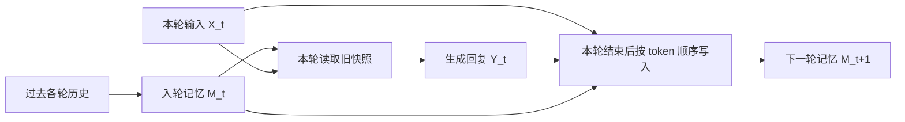

<!--more-->

## 零、写在前面

**MemTensor** 昨天发布了技术报告并且开源了模型权重，今天就宣发满天飞了。

因为前几周一直在看记忆原生的工作，也跑了一些包括 **Metis** 在内的开源方案，做了各种验证后，个人其实并不看好现在走的路线。记忆原生的想法是很好的，但现在的范式还是 **Fast Weight Update**，写入污染、早期记忆衰退这些问题并没有消失。

这次 **MemT-1.0** 的规模就远超之前的 Metis 了，以 **Qwen3.6-35B-A3B** 和 **DeepSeek-V4-Flash** 为 backbone，分别发布了 **MemT-1.0-Nano** 和 **MemT-1.0-Flash**。

模型做得更大，训练投入更多，这次还在一些 Agent Harness 的 bench 上做了测试，试图说明记忆对于自我改进的价值。记忆 bench 的数字也比之前好看了不少，不过和外部记忆系统比，得拆开看具体任务，不能只看一张总分图。

宣发推文里有一个测试迷宫游戏的视频：MemT-1.0 和普通模型第一次的表现接近；第二次，MemT-1.0 靠之前的记忆直接走了最优路线，普通模型仍然像第一次一样试错前进。

那么这些看起来还不错的提升，背后主要做了什么？我的第一感觉还是：**Scale**。

这件事还挺巧。上周我刚做过一些实验，想法就是推理时的 native memory Scale：同一批信息，随着写入次数增加，模型会怎样？

按照我的预期，一开始应该会涨点；继续写入，噪声和干扰也在增加，最后又会掉点，得到一条倒 U 型曲线。

最后 δMem 确实得到了类似的曲线，只是模型规模太小，涨点不明显。Metis 就比较诡异了，持续掉点。

当时我的理解是，δMem 做的是 token-level 信息注入，写入类似 DeltaNet 的更新；Metis 内部还有预训练门控和 top-p token 筛选，问题到底出在哪，很难定位。最后也就没打算继续往这条路线深挖，毕竟做的人不多，大家也不好 follow。

今天看了下 MemT-1.0，整体骨架确实和 Metis 很接近。比较直接的变化是去掉 top-p token 筛选，改成逐 token 更新，再加入 **Mixture-of-Storage（MoS）** 来扩容量。不过它不像常见的稀疏 MoE，所有记忆专家都会参与计算。

还有一个容易忽略的细节：**这次发布、用于主结果的 Nano 和 Flash，记忆专家数其实都是 1。** MoS 的多专家收益来自另外的扩容实验，不能直接拿来解释主模型的全部提升。

总的来说，架构有更新，训练和 infra 也做了不少工作，但我看完还是觉得，主要是在原有路线上的力大砖飞。SGDN-2 的理论推导花了不少篇幅，实际消融涨点却比较有限，这个反差也挺耐人寻味。

原生记忆如果能做好，在很多场景当然大有可为。只是从“把历史写进状态”走到“可靠地持续学习”，中间还有很长一段路，现在的宣发多少还是有点过了……

## 一、Metis → MemT-1.0

Metis 的基本思路，是把历史压缩成模型内部的一份动态状态，让后续生成通过一个额外的记忆分支读它。MemT-1.0 沿用了这个骨架。

这里先分清两个东西：

- **Local Memory**：每条会话各自维护的矩阵状态，在线更新，真正承载这条轨迹里的历史。
- **Hyper Memory**：控制读写的投影和门控参数，离线训练，部署时固定。

所以，“推理时记忆发生变化”不意味着模型主干在持续反向传播。变化的是状态 $M_t$，读写规则 $\phi$ 在在线阶段不变。这也是我前面说它仍属于 Fast Weight Update 路线的原因。

和前作相比，最值得关注的变化可以收敛到四件事：

| 变化 | Metis | MemT-1.0 |
| --- | --- | --- |
| 写入粒度 | 先做 token selection | 保留逐 token 的顺序更新 |
| 更新规则 | GDN | 对称稳定化的 SGDN-2 |
| 容量扩展 | 单块记忆为主 | 提出多专家 MoS，主模型仍为单专家 |
| 记忆训练规模 | 约 406M tokens | 20B CPT + 14B PT，共 34B tokens |

模型本身也大了一圈。两个发布版本的配置如下，数据来自附录 B、Table 6：

| 配置 | Nano | Flash |
| --- | --- | --- |
| Backbone | Qwen3.6-35B-A3B | 准备后的 DeepSeek-V4-Flash |
| 总参数 / 激活参数 | 约 36B / 3B | 约 288B / 17B |
| 可训练记忆参数 $\phi$ | 约 451M | 约 3.609B |
| 记忆挂载层数 | 10 | 20 |
| 每层状态 $H_{kv}\times d_k\times d_v$ | $16\times256\times256$ | $64\times512\times512$ |
| 每轨迹 FP32 动态状态 | **40 MiB** | **1,280 MiB，即 1.25 GiB** |
| 每层记忆专家数 $E$ | 1 | 1 |

注意，“约 10M / 336M dynamic memory”说的是**动态状态元素数**，不是新增可训练参数数。模型参数、会话状态、当前轮 KV Cache，是三笔不同的账。

训练量从约 406M 扩到 34B，超过 80 倍。再加上 backbone、记忆容量和训练目标都变了，整体效果变好并不奇怪。

但如果要问“相比 Metis，到底是哪一项改动贡献了多少”，主表里的跨模型比较还回答不了，需要同 backbone、同预算的匹配实验。后面 Nano 自己的消融会更有参考价值。

## 二、架构

### 2.1 三种状态，以及一个容易看错的时间边界

和 Metis 类似，MemT-1.0 其实就是“原模型旁边挂了一份可读写的矩阵”。

主干 $\theta_b$ 负责原来的语言建模；Hyper Memory $\phi$ 负责学会读写；Local Memory $M_t$ 保存当前会话的历史。训练记忆模块时主干冻结，部署时 $\theta_b$ 和 $\phi$ 都固定，只有 $M_t$ 继续变化。

它在选定的注意力层旁边增加 Memory Attention，和原注意力并行，再把两路输出相加：

$$
A_t^{(l)}=A_{\mathrm{ori},t}^{(l)}+A_{\mathrm{mem},t}^{(l)}.
$$

真正容易混淆的是：**逐 token 更新，指的是写入过程内部的粒度；当前轮生成读取的，仍然是入轮时的旧快照。**

也就是说，在第 $t$ 轮生成回复时，Memory Attention 一直读 $M_t$。本轮输入 $X_t$ 和回复 $Y_t$ 在存储阶段按 token 顺序更新，最终提交为 $M_{t+1}$，供下一轮使用。

当前轮的新信息仍可以通过 backbone 原有的 causal attention 和 KV Cache 被使用。因此“回答时不拼接历史文本”，不等于“没有上下文”或者“没有 KV Cache”。

训练时，论文常把 2,048 tokens 切成一个 step；实际交互里的一个 turn，不必天然等于 2K tokens。这两个边界也要分开。

### 2.2 读取：查询去乘一份固定大小的矩阵

先看最简单的读取。忽略层和通道索引，当前隐状态投影成查询 $q$ 后，执行：

$$
q=\operatorname{L2Norm}(h\widetilde W_Q),\qquad
R=\frac{qM_t}{\sqrt{d_k}}.
$$

读出的 $R$ 还要经过 RMSNorm、输出门控，再并回原注意力分支。输出门使用 SoftCapSiLU，把门值幅度软限制在 $(-2,2)$ 内，避免记忆分支过度放大。

这里读出来的是一个向量，不是一条可展示的文本记录。它不像 RAG 那样返回“第几条证据”，也没有天然的条目 ID。

对 Nano 的单层来说，维度流动可以压成下面这张表：

| 环节 | 张量形状 | 含义 |
| --- | --- | --- |
| 输入隐状态 | $[L,2048]$ | 当前输入或生成 token 的表示 |
| 记忆查询 | $[16,L,256]$ | 16 个通道分别寻址 |
| 单层记忆快照 | $[16,256,256]$ | 约 4 MiB，10 层合计 40 MiB |
| 各通道读取结果 | $[16,L,256]$ | 查询乘对应状态矩阵 |
| 拼接后的记忆输出 | $[L,4096]$ | 门控后与原注意力合流，再投影回主干维度 |

矩阵大小固定，所以这次读取的计算量不随已写入的历史长度增长。但能不能从矩阵里读对信息，是另一个问题。

### 2.3 写入：衰减、擦除、再写入

写入时，每个 token 产生 key、value 和三组门控：

- **遗忘门 $D_i$**：对旧状态逐维衰减。
- **擦除门 $\beta_i$**：控制当前关联方向上要移除多少旧信息。
- **写入门 $\omega_i$**：控制新 value 的写入幅度。

SGDN-2 先构造调制后的键和值：

$$
u_i=\sqrt{\beta_i}\odot k_i,\qquad
z_i=\omega_i\odot v_i.
$$

然后按 token 的先后顺序更新：

$$
M_i=
\underbrace{D_iM_{i-1}}_{\text{旧状态衰减}}
-\underbrace{u_i^\top\bigl(u_iD_iM_{i-1}\bigr)}_{\text{沿当前方向擦除}}
+\underbrace{u_i^\top z_i}_{\text{写入新关联}}.
$$

这里 $M_i$ 表示本轮写入过程中的中间状态，初值来自入轮快照 $M_t$；最后一个 token 写完，才提交为下一轮的 $M_{t+1}$。

这不是把一句话原样塞进一个槽。每写一个 token，都可能修改已有矩阵中的一部分关联。顺序更新让后面的信息有机会修正前面的关联，同时也带来了覆盖和干扰。

**为什么去掉 token selection 值得关注？** 因为先筛掉 token，相当于在写入前就做了一次不可逆的信息丢弃；而逐 token 更新，把保留、衰减和修正更多地交给连续门控来处理。

但全 token 写入也不意味着信息都能留下。能写进去多少、后续会不会被冲掉，仍然取决于门控、容量和训练。

### 2.4 SGDN-2 到底修了什么

GDN-2 的问题出在擦除方向不对称。它按 $a=\beta\odot k$ 计算擦除幅度，却沿 $k$ 做减法：

$$
A_{\mathrm{GDN2}}=I-k^\top(\beta\odot k).
$$

当各维 $\beta$ 不一样时，$a$ 通常不再与 $k$ 平行。结果是某些方向上的状态，即使没有新写入，也可能被一次“擦除”放大。

SGDN-2 把门控开根号，分到左右两侧：

$$
u=\sqrt{\beta}\odot k,\qquad
A_{\mathrm{SGDN2}}=I-u^\top u.
$$

这样，读取擦除量的方向和执行擦除的方向就对齐了。满足论文的归一化与门值条件时，这个擦除算子非扩张，即 $\|A\|_2\le1$。

可以用一个二维例子看差别。取

$$
k=\left[\frac1{\sqrt2},\frac1{\sqrt2}\right],\quad
\beta=[0.99,0.01],\quad
y=\left[\frac1{\sqrt2},-\frac1{\sqrt2}\right].
$$

只做擦除，暂时关闭衰减和新写入：

| 结果 | GDN-2 | SGDN-2 |
| --- | --- | --- |
| 擦除后的 $y'$ | 约 $[0.3606,-1.0536]$ | 约 $[0.3923,-0.7387]$ |
| 擦除前的范数 | 1 | 1 |
| 擦除后的范数 | **约 1.1136，放大了** | **约 0.8364，未放大** |

这组数对应附录 C 的二维说明，用来解释算子性质，不是记忆准确率实验。SGDN-2 相对原来的 $k$ 改了方向，因此也不能说它会完整保留所有与原 $k$ 正交的分量；它保证的是不因这个擦除算子凭空放大范数。

原文还有一个很抓眼球的推论：标准 GDN-2 若要靠统一衰减满足最坏情况下的一致收缩保证，对应半衰期只有约 **4.82 tokens**。

这里要收住一点：这不是说 GDN-2 实际只能记住 5 个 token，也不是说它跑长序列必然爆炸。它说明的是，这条最坏情况稳定性保证对衰减要求很苛刻。

对称化让遗忘门不必额外承担压制这一放大的任务。论文据此把遗忘半衰期初始化在 Nano 的 $[2048,32768]$、Flash 的 $[128,32768]$ token 区间。

但**初始化半衰期不等于实际事实保留时长**。后续擦除、新写入和读出误差都还在，不能直接理解成“保证记住 32K tokens”。

### 2.5 MoS：扩了容量，也扩了计算

MoS 做的事情很直观：把每层一份记忆矩阵扩成 $E$ 组专家状态，让不同专家承载不同的信息。

它共享一组专家地址 $C$，但分别学习写路由和读路由：

$$
\alpha_s=\operatorname{Softmax}(hW_sC^\top),\qquad
\alpha_u=\operatorname{Softmax}(hW_uC^\top).
$$

写入时，$\alpha_s$ 缩放对应专家的擦除门和写入门；读取时，各专家输出按 $\alpha_u$ 加权求和。

两个细节：

1. **它是稠密路由。** 所有专家都参与计算，权重小不等于跳过这个专家。所以扩容量的同时，状态、投影计算和中间激活也会增加。
2. **写路由不缩放遗忘率。** 一个专家即使几乎没有接收当前 token 的新写入，也仍然会自然衰减，不能把低路由权重理解成“旧记忆被完全保护”。

另外，读写两套路由也需要学会配合。写入时主要放进专家 1，提问时却主要去读专家 2，扩出来的空间也未必有用。共享地址提供了对齐的基础，但没有自动保证每个事实都能被正确寻址。

这也是我对后续版本的一个猜测：相比单纯继续堆专家，**怎么找到该读、该写的那份状态**，可能更值得做。

## 三、Training & Infra

### 3.1 backbone 准备

论文在挂载记忆模块之前，先对 Flash 的 backbone 做了准备。这里的出发点：模型缺的到底是新信息，还是把已有能力稳定用出来的流程？

团队先对任务重复采样，分成“稳定解出”“偶尔解出”“没有解出”几类，再通过注入事实、程序提示或评分规范来诊断失败原因。

报告里的两个观察是：

- 对基座 8 次尝试都没做出的任务，常规后训练之后，准确率仍只有 **1.6%–4.0%**。
- 在一组困难知识探针上，把相关事实直接放进上下文，准确率从 **27% 提升到 91%**。

这支持了团队的分工思路：先用后训练改善行为可靠性，再让记忆负责提供交互中出现的新信息。至于“后训练只能重新加权、绝不可能增加知识”这种更强的说法，单靠这组实验还下不了结论。

数据合成也按失败原因处理：稳定做对的用于回放，偶发做对的筛选成功轨迹，缺流程的加入引导示范，补充后仍做不出的则剔除。

最终 Flash 的基座准备使用了 **126.5K 条轨迹、2.4B tokens**，其中约 1.1B tokens 计入损失；六项核心基准均分提升约 **6.3 个百分点**。

这笔投入和后面的记忆训练是两件事。后面说的 **34B，是 20B CPT + 14B 记忆后训练**，不包含这笔 Flash 主干准备数据。否则把收益全记在记忆模块头上，就不太合适了。

### 3.2 CPT：先学会跨片段使用状态

第一阶段是 **20B tokens 的 continued pre-training（CPT）**。

训练把 64K 的打包序列切成连续、不重叠的 2K 片段。当前片段的注意力只能看到自己，前面片段的信息要通过 $M_t$ 带过来。

监督仍然是普通 next-token 交叉熵。这样做，相当于迫使模型学习：当前上下文不够用时，应该去读那份状态。

不过会用状态辅助续写，不等于就会回答复杂的历史问题，所以还有第二阶段。

### 3.3 记忆后训练：让“只看状态”的学生模仿“看全历史”的老师

第二阶段使用 **14B tokens**，统一组织成“历史—查询—回答”的形式，覆盖记忆语言建模、存储与利用任务，以及长程记忆问答。

这里的教师和学生用的是同一冻结 backbone，但能看到的信息不同：

| 模型 | 能看到什么 |
| --- | --- |
| 教师 | 完整历史 $C_{<t}$、当前问题、答案前缀 |
| 学生 | 历史压缩出的 $M_t$、当前问题、相同答案前缀 |

老师能翻原文，学生只能靠记忆，目标是让学生的下一 token 分布尽量接近老师。

为了降低存储与通信成本，只保留教师概率最高的 Top-64 tokens，重归一化成 $\hat q$，再计算前向 KL：

$$
\mathcal L_{\mathrm{KD}}
=T_d^2\sum_{v\in\mathcal K}
\hat q(v)\log\frac{\hat q(v)}{p^{T_d}(v)},\qquad T_d=1.
$$

教师在 Top-64 内重归一化，学生仍在完整词表上归一化。所以学生如果把很多概率分给这 64 个候选之外的 token，也会受到惩罚。

训练只在回答位置计算损失，历史和问题本身不直接产生预测损失。但回答位置的梯度，可以沿读取和状态更新回传到前面的写入门控，教它在历史里应该留下什么。

注意这里是：**off-policy**。这里的轨迹和答案前缀是固定的，训练时做 teacher forcing，不是让学生自由跑出一条新轨迹再学。

我觉得这套目标比“压缩得越多越好”要具体得多：它直接教模型保留那些对回答有帮助的信息。只是老师也可能用错历史，下一 token 分布对齐并不额外保证事实可追溯、可删除，部署时自由生成也仍有分布偏移问题。

### 3.4 Infra

逐 token 写入在逻辑上是递归的，直接一个 token 一个 token 地跑，吞吐不会好看。MoS 又会把多个专家的投影和中间激活一起放大。

论文主要做了两件事。

**第一件是分块写入，并把读取和写入分开。** 利用 rank-one 更新的结构，Chunked WY 把每 64 tokens 的递推转成更适合硬件执行的线性代数操作。每个 2K step 内，读取仍面向步初快照，写入则用 32 个 64-token 微块推进到下一份状态。

这和前面的时间语义是对得上的：读取可以批量并行，不必等待本轮每一个 token 写完后再读一次新状态。

**第二件是窗口化执行和重计算。** 不一次性物化整段序列、所有专家的投影，而是按完整 step 分窗口处理；保留边界状态，反向传播时重算内部激活。

附录 F 的单模块实验比较直观：

| 32K pack、4-expert MoS block | 全包执行 | 4K 窗口执行 |
| --- | --- | --- |
| 峰值已分配显存 | 47.83 GiB | **9.49 GiB** |
| 前向 + 反向中位耗时 | 463.0 ms | 470.6 ms |
| 变化 | — | 显存约 −80.1%，耗时约 +1.6% |

这个工程收益确实不错。不过它是**单个 MoS block、合成输入**下的测量，不能直接换算成整个 Flash 训练只要多少显存，或者完整训练也只多 1.6% 时间。

### 3.5 Serving：$O(1)$ 到底省在哪

记忆写完之后，每条轨迹持久保存的是定长状态：Nano 40 MiB，Flash 1,280 MiB。历史再长，这份矩阵本身也不继续变大。

论文在 BEAM、两张 GPU、单请求、HF 推理、强制生成 128 tokens 的设置下，报告 Nano 在 128K 历史时，端到端约 **1.86× 加速**，持久化状态相对 full-context KV Cache 约 **66× 压缩**；到 256K 时，端到端加速约 **3.99×**。

但短历史并没有同样的收益，报告里大约到 32K 附近才与 full context 相当。

这些数字对应的账要算清楚：

- **40 MiB / 66×**：算的是每轨迹持久化逻辑状态，不含共享模型权重和在线工作区，也不等于 GPU 峰值显存。
- **约 104–112 ms 的查询 TTFT**：历史已经准备完之后的查询延迟，不包括把历史写进记忆的时间。
- **$O(1)$**：相对于历史长度，单条轨迹的状态大小固定。会话数、专家数增加，总成本仍然增长，当前轮 KV Cache 也仍然存在。

所以它省的是长期保留历史的成本。首次写历史要付钱，后续查询复用得越多，越有机会把这笔钱摊薄。Flash 每会话 1.25 GiB 的状态，也不能因为写了 $O(1)$ 就当它很小。

## 四、实验

### 4.1 11 项记忆基准：参数化记忆领先，外部记忆仍有差距

论文把对照分成了两类：一类回答时不提供历史文本，靠内部参数或状态；另一类直接给 full context，或者检索出文本片段再回答。

11 项宏平均上，Flash 是 **50.6**，Nano 是 **47.0**，领先表内最强的参数化记忆基线 Temp-LoRA（38.1）。这说明这套整体系统是有效的。

但和外部记忆比，不能笼统地说已经打平：

| 设置 | 11 项均分 | LongMemEval-S | BEAM-1M |
| --- | --- | --- | --- |
| MemT-1.0-Nano | 47.0 | 32.6 | 35.8 |
| MemT-1.0-Flash | 50.6 | 37.2 | 37.0 |
| DenseRAG，DeepSeek 主干 | 57.3 | 69.4 | 43.7 |
| MemOS，DeepSeek 主干 | 68.6 | 83.2 | 72.6 |

数据来自 Table 2。这里的 DeepSeek 文本记忆对照也不能当作与 Nano 同 backbone 的严格消融。

Flash 在 MemBench、PersonaMem、LoCoMo 上有不错的结果，分别是 73.5、61.6、65.1。但到了 LongMemEval-S、MemoryAgentBench 这类长历史任务，37.2、17.4 的分数，离“历史可靠留存”还有明显距离。

BEAM 的 full-context 还受 256K 截断限制。接近一个看不到完整历史的 full-context 结果，也不能理解成已经接近完整历史的信息上限。

另外，11 个任务等权取平均，会把样本量、长度和能力要求的差异压平；判分又使用 LLM-as-Judge。对我来说，宏平均适合看总体趋势，具体事实有没有记住、有没有更新对，还得看分桶结果和失败样例。

### 4.2 两个补充实验：状态里装了什么，无关记忆会不会捣乱

**低秩压缩实验**比较有意思。团队对 Nano 的 $256\times256$ 状态矩阵做在线 SVD 截断：PersonaMem 在中间秩、约 $k=16$–$32$ 时就接近饱和；LoCoMo 则更依赖更高的秩，直到满秩仍有提升，不过 $k\ge64$ 后边际收益减小。

我的理解是，这提示用户画像这类较粗的特征，可能更容易集中在低秩子空间；细粒度、多跳事实则需要更多容量。这是一条很有用的现象，但还不是对矩阵内部“每类信息存在哪里”的直接证明。

**无关记忆干扰实验**则是在测试前写入其他领域的示范。Flash 在六项通用基准上的均分与同噪声设置的基座持平，Nano 平均下降约 0.9 分。

这个结果支持它在所测设置下大体保留了通用能力。不过 Nano 的 LiveCodeBench v6 仍下降了 5.8 分，不能只报平均就说完全没有影响。

而且写几道无关题，与数万次写入之后的污染不是同一种压力。它还不足以说明输出门能在长期运行中自动屏蔽所有噪声。

### 4.3 Scaling：离线训练更多，与在线写入更多，是两回事

论文测了两个维度。

第一个是**固定容量，增加后训练曝光**。在同一份 14B 语料上训练两轮，均分从 CPT 初始点的 36.65，提升到第一轮末的 45.40，再到第二轮末的 46.80。LoCoMo 也从第一轮末的 55.39 提升到 57.53。

这说明读写策略还有继续优化的空间。但这里增加的是离线训练步数，不是部署时单纯重复写入状态。所以它和我前面想测的“多写几次会怎样”，并不是同一个 Scale。

第二个是**增加 MoS 专家数**。2 专家和 4 专家在早期差距不大，训练到 5,500 步时，4 专家均分高了 **2.69**，LoCoMo 高了 **2.20**。

比较合理的解读是：更大的状态，需要足够的训练才能用起来。现在只有 2/4 专家的有限对照，还不能往无限扩容的 scaling law 上推，也缺少按训练 FLOPs 和状态大小归一化后的收益曲线。

### 4.4 Agentic Coding：把检索到的经验装进原生状态

这部分我觉得比单纯的记忆问答更有意思。它尝试让记忆承载程序性经验，例如遇到某种报错时，先复现、再检查边界、最后验证修改。

不过先别把它理解成模型自己从失败里长出了经验，整条管线还是有不少外部环节：

1. 从 **41,057 条成功修复轨迹**出发，用 DeepSeek-V4-Pro 提炼、聚类和质检，得到 **1,040 条经验**。
2. 另外生成 **18,820 条原始轨迹**，在失败轨迹里找出 **19,950 个候选断点**。
3. 用 **BGE-M3** 检索经验，从相同断点尝试不同经验组合，运行 **199,500 条反事实分支**。
4. 筛选注入经验后通过测试的续写，经质检留下 **42,403 条训练样本**。

训练时，先把经验写入记忆，再关闭记忆读取回放失败前缀；到断点后开启读取，用 full-suffix Top-64 KD，让学生模仿上下文里直接看到经验的教师。

评测也有两个写入时机：执行前写入，或者由 harness 在报错、空观察、重复动作等条件下触发。经验仍由外部系统挑选，单个 episode 最多触发一次写入。

指标：

| 指标 | 含义 |
| --- | --- |
| Avg. Success | 三次独立运行的平均成功率 |
| $\mathrm{pass}@3$ | 三次至少成功一次的任务比例 |
| $\mathrm{pass}^3$ | 三次全部成功的任务比例 |

所以 Verified 的 **+8.80 个百分点**，说的是三次全过率；平均成功率的提升是 **+3.66 个百分点**。Multilingual 也是类似，三次全过率 +10.00，平均成功率 +3.56。

原生记忆和文本经验接近，有些配置略高，也有配置更低。例如 Multilingual 执行前写入时，文本经验平均 64.22%，原生记忆 62.89%。目前更稳妥的结论，是**检索到的经验确实可以经由矩阵状态影响后续行为**。

这部分还有一个我觉得很值得记下的训练结果：**验证集 NLL 更低，不代表 Agent 成功率更高。**

附录 E.2.4 的 Full-Suffix-Max2 对照中，CE 的验证 NLL 是 0.1795，低于 KD 的 0.2005；但开发集执行成功率，CE 只有 **37.5%**，KD 是 **54.3%**。First-Step-Max2 的差距更大，CE 12.5%，KD 52.0%。

一种合理解释是，只拿到有损记忆的学生，很难逐字复刻一条教师轨迹；软分布给了它更多可行输出的余地。但这仍是对结果的机制解释，不能只凭 NLL 和成功率的反差，就断言内部已经学到了某种抽象策略。

## 五、Rethink

数字比前作好看了很多，但看完之后，我最在意的还是下面几个问题。

### 5.1 SGDN-2 的实际贡献有多大？

Table 4 基本把这个问题摊开了：

| Nano 设置 | 11 项均分 | 表中相对差值 |
| --- | --- | --- |
| 完整模型 | 47.0 | — |
| 换回 GDN-2 | 46.4 | 约 −0.5 |
| 换成 GDN | 46.7 | 约 −0.3 |
| 改为 turn-level 汇总写入 | 41.0 | −6.0 |
| 不做 CPT | 44.9 | −2.1 |
| 不做 PT | 36.3 | −10.7 |

表内均分和差值分别经过舍入；正文给出的完整模型与 GDN-2 未舍入均分是 46.97、46.43，所以对应差距约 0.54。

从这组结果看，**更新粒度和后训练的影响，明显大于更新公式的替换**。但不同消融的差值不能直接相加，训练对照也不等于控制了相同总训练预算的因果分解。

SGDN-2 的数学修正是有价值的，可它在这组常规基准上的均分收益确实不大。我的疑问是：它的主要价值，到底是让训练更稳，还是让最终模型记得更多？这两件事需要不同的实验回答。

标准 GDN-2 没在评测里崩溃，也不奇怪：最坏情况下的算子上界，不代表实际键向量和门控一定会反复走到那个方向。至于是不是训练学会了避开病态区间，还需要看门控和状态范数，不能直接从分数倒推出原因。FP32 也只能缓解精度问题，不能消除算子本身的放大性质。

如果要把 SGDN-2 的独立价值讲扎实，我更想看百万 token 连续写入时的状态范数、NaN 比例、数值漂移，以及按事实年龄分组的召回率。现在的数据更像说明它提供了更好的稳定性条件，还没有说明这项修正决定了整体效果。

### 5.2 固定容量省下了存储，信息损失谁来承担

Flash 的整体均分是 50.6，MemOS 是 68.6；LongMemEval-S 则是 **37.2 对 83.2**。这不是一点点差距。

定长矩阵必须把不断增长的历史挤进有限状态。相近的 key 会干扰，后续擦除和写入也可能影响旧关联。这里不是说 $d_k=256$ 就只能存 256 条事实，但有限精度、有限容量的状态，确实不可能无损保留无限新增的细节。

这和前面 SVD 实验的现象是能对上的：画像、风格可能容易压缩，具体日期、数字、专有名词和多跳关系则更吃容量。

不过“答错了”还可能有几种原因：压根没存住、存住了却没读对、读到了但没用对。论文还没有把这几步完全拆开测。所以容量瓶颈是合理怀疑，不能把每一个失败都归结为矩阵装满了。

还有一个实际问题是，**文本记忆至少能定位条目、回看来源。矩阵状态里一条错误信息写进去之后，怎么精确删掉**，**怎么确认旧版本已经撤回**，**怎么向用户解释答案依据**？这些能力，光靠召回均分也看不出来。

### 5.3 MoS 讲了很多，发布模型为什么还是单专家

附录 B 写得很清楚，两个主模型都是 **$E=1$**。这不影响 MoS 扩容实验本身成立，但说明它还没有成为这次主结果的来源。

为什么没放进最终配置？报告没有给出完整的部署取舍，不能替作者下定论。不过稠密执行的代价是摆在那里的。

只看每会话状态，扩到 4 专家，Nano 就从 40 MiB 到 160 MiB，Flash 从 1,280 MiB 到 5,120 MiB，也就是 **5 GiB**。专家相关的投影计算和训练激活也会增加，路由与共享部分则不能一概算成严格四倍。

**所以我还是觉得，后续有可能往稀疏读写、语义寻址和 infra 优化走**。

**但稀疏 MoS 也不是加一个 Top-k 就结束了：没读到的专家怎么找回来，没激活的专家怎么遗忘，读写路由怎么一致，都还有问题。**

### 5.4 Flash 多花的成本，换来了多少收益

Flash 相比 Nano，总参数约 8 倍，激活参数约 5.7 倍，可训练记忆参数约 8 倍，动态状态则是 **32 倍**。

换来的 11 项均分提升是 **3.6 分：50.6 对 47.0**。

还有局部倒挂：PerMemSafe 是 Nano 38.7、Flash 33.5；Memora 是 Nano 23.9、Flash 20.5。更大的版本并没有在每类任务上都占优势。

我会怀疑更大的记忆模块还没训够，也会怀疑 Flash 在压缩稀疏注意力层上的挂载和初始化，是否比 Nano 的全注意力分支更难适配。

但目前这两条都只是猜测。两个版本同时改了 backbone、挂载位置和状态几何，不能只凭分数就诊断成欠训练，或者归罪于某种初始化。真要解释，需要把这些变量拆开。

至少从部署角度看，单会话多花 32 倍状态，平均只多 3.6 分，这个交换并没有让我特别信服。

### 5.5 Agent 的提升，更像是把能做对的事做稳

三次全过率涨了不少，三次至少过一次的比例却基本没变，有些设置甚至略降。这是 Agent 实验里最值得看的反差。

我的理解是，当前经验更像在提醒模型遵守一些有效流程，减少本来能做对、却偶尔跑偏的情况。数据支持“可靠性改善”这个解释；至于探索上限，至少从这组 $\mathrm{pass}@3$ 里还看不出明显扩张。

这也不等于模型从此不可能获得新能力，只是当前实验没有把这一点证明出来。

更关键的是，经验还来自外部库，选择还靠 BGE-M3，训练还需要近 20 万条沙盒干预分支。距离“自己发现经验、判断价值、写入、清理，再持续变强”的在线闭环，仍然有不小的距离。

附录 E、Table 13 还有一组对照很有意思：Multilingual 执行前写入时，如果事后按评测结果挑每题最好的文本经验，平均成功率能到 **70.56%**；固定 rank-1 文本经验是 64.22%，当前原生记忆是 62.89%。

这个 Per-Task Best 是事后挑选的参考，真实部署当然不能偷看结果。但它提示，**经验选得对不对，可能比以文本还是矩阵的形式装进去，更值得先解决。**

## 六、总结

看完之后，我的判断没有特别大的变化：**MemT-1.0 是一次有实质投入的 Scale，但还没有解决我对当前原生记忆路线的主要疑问。**

逐 token 写入和全上下文教师蒸馏，确实把效果往前推了一截；分块算子、快照读写和窗口重计算，也让这条路线更接近能实际训练和部署的系统。这些工作该认可。

只是 SGDN-2 的理论稳定性、记忆 bench 的均分提升，以及 Agent 三次全过率的上涨，分别回答的是不同问题。把它们串起来直接讲成持续学习、自主进化，我觉得还是走得太快了。

我仍然更看好混合方案：把高频的用户偏好、交互风格、程序性经验留在原生状态里，减少反复往上下文塞同一批信息；具体数字、日期、长尾事实和需要追溯来源的记录，继续交给外部记忆按需检索。

至于端侧，我觉得值得探索的是这种分工，而不是看到 Nano 这个名字就默认它已经很轻。毕竟当前 Nano 也有约 36B 总参数，实际能不能跑，还要看量化和部署条件。

写入污染、早期记忆衰退、固定容量如何外推，这几件事不知道是否能有更清楚的答案。

## 附：GDN-2 稳定性推导

主线里保留了直觉，这里补上原文附录 C 的关键步骤。以下忽略层和通道索引，采用行向量约定，$\|k\|_2=1$。

### A.1 非对称擦除为什么可能放大状态

令 $a=\beta\odot k$，则标准 GDN-2 的擦除算子是

$$
A=I-k^\top a.
$$

把 $a$ 拆成平行于 $k$ 和垂直于 $k$ 的两部分：

$$
a=\rho k+\gamma e,\qquad
\rho=ka^\top,\qquad
\gamma^2=\|a\|_2^2-\rho^2,
$$

其中 $e$ 是单位向量，且 $ek^\top=0$。当 $\gamma>0$ 时，在 $\{k,e\}$ 这组正交基里，非平凡子块为

$$
A_2=
\begin{bmatrix}
1-\rho & -\gamma\\
0 & 1
\end{bmatrix}.
$$

因此，沿 $e$ 的单位状态经过擦除后，变成 $eA^\top=e-\gamma k$，范数平方是

$$
\|eA^\top\|_2^2=1+\gamma^2>1.
$$

问题就在这里：名义上做擦除，却可能把状态推得更大。

### A.2 约 4.82 tokens 是怎样来的

论文给出擦除算子的最坏情况上界

$$
1\le\|A\|_2<\frac2{\sqrt3}\approx1.1547.
$$

若用统一上界 $\bar d$ 约束遗忘门，取

$$
\|AD\|_2\le\frac2{\sqrt3}\bar d<1,
$$

就需要 $\bar d<\sqrt3/2$。对应半衰期的边界值为

$$
t_{1/2}=\frac{\ln2}{-\ln\bar d}
<\frac{\ln2}{-\ln(\sqrt3/2)}
\approx4.82\ \text{tokens}.
$$

这是用最坏情况上界建立一致收缩的**充分条件**，不是实际记忆时长的测量，也不是所有稳定运行方式都必须满足的必要条件。

### A.3 对称化之后，能保证什么

改成 $u=\sqrt\beta\odot k$ 后，

$$
A=I-u^\top u.
$$

沿 $u$ 的分量缩小为原来的 $1-\|u\|_2^2$，正交补上的分量不变。在 $\|u\|_2^2\le1$ 的条件下，$\|A\|_2\le1$。

这个结论消除了擦除算子本身的放大问题。整个递归系统还包含衰减、新写入和有限精度计算；长期状态是否有界，仍要结合相应条件来看。**非扩张擦除，不等于无限历史都能稳定、准确地记住。**
